# Говорилка — озвучка чата Twitch

Настольное приложение для Windows, которое читает сообщения Twitch вслух. RHVoice синтезирует речь локально; при выборе RVC-модели звук дополнительно преобразуется под голос модели. Приложение использует установленный на компьютере движок — текст и аудио не отправляются в облачный сервис синтеза.

## Установка и первый запуск

1. Запустите `Govorilka Setup 1.0.0.exe` и установите приложение. Если установщик получен не с официально подписанного сайта, Windows может показать предупреждение: текущая сборка не подписана сертификатом издателя.
2. При первом запуске укажите Twitch-канал, имя аккаунта бота и OAuth-токен этого аккаунта.
3. Приложение сохраняет токен отдельно от настроек и шифрует его средствами Windows. Токен не передаётся в интерфейс приложения.
4. При первом запуске приложение автоматически скачает и подготовит RVC-движок, стандартные модели, Python/CUDA и RHVoice. Ход установки виден в окне приложения; она может занять много времени и несколько гигабайт диска.
5. Когда движок готов, нажмите **Подключить Twitch**. Если установка не удалась, на главном экране можно повторить её.

Загрузки требуют интернета и свободного места. Код RVC скачивается из официального репозитория Applio, закреплённого на версии 3.2.9; стандартные веса загружаются из зафиксированной версии официального хранилища и проверяются по SHA-256. Python/CUDA-настройка рассчитана на совместимую NVIDIA GPU. Приложение нельзя устанавливать в папку, куда у пользователя нет прав на запись.

## Основной экран и настройки

- **Обзор** показывает состояние локального движка и подключения к Twitch, а также пользователей с сохранёнными голосами.
- В таблице пользователей можно изменить голос или выбрать **Голос по умолчанию**, чтобы удалить персональное назначение.
- **Папка моделей** открывает место, где хранятся RVC-модели. Разложите файлы модели по папкам, описанным ниже, и нажмите **Обновить модели**.
- **Настройки** содержат громкость, голос по умолчанию, RHVoice-голоса для мужских и женских RVC-моделей, паузу между сообщениями, параметры RVC, список игнорируемых пользователей и правила замены текста.
- Громкость меняет уровень готовой записи перед воспроизведением. Она не изменяет общую громкость Windows.

## Как работает озвучка

```mermaid
flowchart LR
    Chat["Twitch-чат"] --> Main["Electron main<br/>подключение и логика приложения"]
    Main --> Processor["messageProcessor.ts<br/>команды, фильтры, выбор голоса"]
    Processor --> Queue["audioQueue.ts<br/>очередь и воспроизведение"]
    Queue --> Service["rvcService.ts<br/>запрос к локальному движку"]
    Service --> Worker["Python worker<br/>rvc_worker.py"]
    Worker --> RH["RHVoice<br/>текст → WAV"]
    RH --> Direct{"Выбран RHVoice<br/>или RVC-модель?"}
    Direct -->|"RHVoice"| WAV["WAV-запись"]
    Direct -->|"RVC-модель"| RVC["RVC<br/>преобразование голоса"]
    RVC --> WAV
    WAV --> Player["Воспроизведение в Windows"]
    Player --> Cleanup["Временная WAV-запись удаляется"]

    UI["React-интерфейс"] <-->|"Типизированный IPC"| Main
```



**Electron** — настольная оболочка приложения. В Electron есть два важных процесса:

- **Main process** — серверная часть desktop-приложения. Он подключает Twitch, управляет Python-процессом, хранит настройки и токен, запускает воспроизведение.
- **Renderer** — окно приложения, в котором работает React. Оно показывает панели настройки и состояние приложения.
- **Preload/IPC** — узкий мост между окном и main process. Например, интерфейс отправляет запрос «подключиться к Twitch», main process выполняет его и возвращает состояние. Это не даёт странице прямого доступа к файловой системе, системным командам или секретному токену.

**Python** здесь не заменяет Electron или React: это локальный рабочий процесс для RHVoice и RVC. Main process запускает `rvc_worker.py` один раз; TypeScript и Python обмениваются командами и ответами в формате JSON через стандартный ввод/вывод. Для голоса RHVoice worker создаёт WAV без RVC. Для RVC-модели он сначала создаёт исходный RHVoice WAV, преобразует его и удаляет промежуточный файл. После воспроизведения приложение удаляет итоговую временную запись.

## Голоса и команды Twitch

В чате доступны команды:

- `!voices` — список доступных RVC-моделей и голосов RHVoice.
- `!voice` — показать свой текущий голос.
- `!voice KingArtas` — выбрать RVC-модель.
- `!voice anna` — выбрать голос RHVoice; он синтезирует речь напрямую, без преобразования RVC.
- `!voice RHVoice: anna` — явно выбрать RHVoice, если его имя совпадает с именем RVC-модели.
- `!setvoice <имя>` — алиас для выбора голоса, как `!voice <имя>`.

Если пользователь выбрал имя, которого нет в списке, бот сообщает об ошибке и сохраняет прежний голос.

### Добавление RVC-модели

В главном окне нажмите **Папка моделей**. Создайте для модели отдельную папку в одной из категорий:

```text
voices/
├── male/
│   └── НазваниеМодели/
│       ├── model.pth
│       └── model.index       (необязательно)
└── female/
    └── ДругаяМодель/
        ├── model.pth
        └── model.index       (необязательно)
```

Имя вложенной папки показывается в списке голосов и используется в команде `!voice`. В каждой папке модели должна быть одна `.pth`-модель. Файл `.index` необязателен. Пол и RHVoice для исходной речи определяются родительской папкой (`male` или `female`), а не названием модели.

## Где хранятся файлы

Настройки и зашифрованный токен хранятся отдельно в данных пользователя Windows. Локальная Python/CUDA-среда и RVC-модели хранятся рядом с приложением. При запуске сборки из папки `release` приложение повторно использует `env`, `tools` и `voices` из корня проекта, если там найдена существующая среда Python.

В упрощённой схеме каталог проекта/установки выглядит так:

```text
govorilkaClient/
├── src/                  исходный код приложения
│   ├── electron/
│   │   ├── main/         главный процесс, сервисы и Python worker
│   │   ├── preload/      безопасный API для окна
│   │   └── shared/       типы конфигурации и IPC-контракт
│   └── renderer/         React-интерфейс и стили
│       ├── app/          точка входа и глобальные стили
│       └── shared/styles/ SCSS-переменные и миксины
├── engine/               загружаемый движок RVC и стандартные модели (не в Git)
├── setup-runtime.ps1     установка локальной Python/CUDA-среды
├── requirements-local.txt Python-пакеты и RHVoice
├── voices/               RVC-модели для разработки
├── env/                  локальная Python-среда для разработки
├── tools/                файлы Miniconda для установки Python-среды
├── temp/                 временные WAV-файлы при разработке
├── config.json           конфигурация для переноса старых настроек
├── node_modules/         пакеты JavaScript/TypeScript
├── out/                  сборка Electron main, preload и React
├── release/              готовый Windows-установщик
└── .idea/                настройки IDE JetBrains (не нужны для запуска)
```

Подкаталоги движка и локальной среды:

| Путь | Назначение |
|---|---|
| `engine/rvc/infer/` | Код, запускающий преобразование входного WAV в RVC-модель. |
| `engine/rvc/lib/` | Внутренние алгоритмы, предсказатели тона и инструменты движка. |
| `engine/rvc/configs/` | Конфигурации архитектур моделей RVC. |
| `engine/rvc/models/embedders/` | Предобученные модели, извлекающие признаки речи, например ContentVec. |
| `engine/rvc/models/predictors/` | Предобученные модели для определения высоты тона, например RMVPE и FCPE. |
| `env/Lib/site-packages/` | Установленные Python-пакеты, включая RHVoice, PyTorch и зависимости RVC. |
| `env/Library/` | Нативные DLL и библиотеки Python-пакетов для Windows. |
| `tools/miniconda/` | Частная копия Miniconda, используемая при создании/обслуживании локальной Python-среды. |
| `tools/miniconda/pkgs/` | Кэш установочных пакетов Conda; это не модели голосов. |
| `tools/miniconda/condabin/` | Команды Conda, которые вызывает установочный скрипт. |

`__pycache__/` и файлы `.pyc`, если они появляются рядом с Python-файлами, — автоматически создаваемый кэш Python. Его не нужно редактировать или переносить как модель. `engine/`, `node_modules/`, `env/`, `tools/miniconda/`, `voices/`, `temp/`, `out/` и `release/` исключены из Git: это скачанный код/модели, локальные пользовательские данные, зависимости или результаты установки/сборки.

В **установленной desktop-версии** RVC-движок, Python-среда, Miniconda, стандартные и пользовательские модели, а также временные файлы лежат рядом с EXE. Они автоматически загружаются или создаются при первом запуске и не включаются в Git/установщик. Для установки среды приложению нужен доступ на запись в эту папку. Настройки и зашифрованный токен остаются в профиле пользователя Windows:

```text
папка приложения/
├── Govorilka.exe
├── resources/        код приложения и установочный скрипт
├── engine/           загруженный RVC-движок и стандартные модели
├── env/              Python, RHVoice, PyTorch/CUDA и пакеты
├── tools/            Miniconda для установки среды
├── voices/           добавленные пользователем RVC-модели
└── temp/             промежуточные и готовые WAV-файлы

папка данных пользователя Windows/
├── config.json       настройки, перенесённые из старого config.json
└── credentials.enc   зашифрованные Twitch username и OAuth-токен
```

## Разработчикам: устройство исходников

Код разделён по процессам Electron и ответственности:

| Путь | Назначение |
|---|---|
| `src/electron/main/index.ts` | Запускает главное окно и регистрирует IPC-обработчики. |
| `src/electron/main/configStore.ts` | Загружает, нормализует и сохраняет настройки. |
| `src/electron/main/services/twitch.ts` | Подключается к чату и передаёт сообщения обработчику. |
| `src/electron/main/services/messageProcessor.ts` | Проверяет команды, фильтры и выбирает голос для сообщения. |
| `src/electron/main/services/audioQueue.ts` | Управляет очередью синтеза и воспроизводит WAV. |
| `src/electron/main/services/rvcService.ts` | Находит модели и обменивается запросами с Python worker. |
| `src/electron/main/runtime/rvc_worker.py` | Локальный процесс RHVoice/RVC, запущенный главным процессом. |
| `src/electron/shared/config.ts` | Типы настроек, которые используют main и renderer. |
| `src/electron/shared/contract.ts` | Типы состояния, голосов и IPC API между процессами. |

`src/renderer` следует **Feature-Sliced Design (FSD)** и содержит только код React-интерфейса:

| Папка | Назначение |
|---|---|
| `app/` | Точка входа React, корневой компонент и общие стили приложения. |
| `app/ui/` | Корневой компонент `App` и его стили. |
| `pages/` | Целые экраны: первый запуск, обзор и настройки. |
| `pages/first-run/ui/` | Форма первоначальной настройки Twitch. |
| `pages/dashboard/ui/` | Экран обзора и состояния приложения. |
| `pages/settings/ui/` | Форма настроек приложения. |
| `widgets/` | Крупные элементы интерфейса, например навигация. |
| `widgets/navigation/ui/` | Кнопки переключения между экранами. |
| `features/` | Функции интерфейса, например статусы движка и таблица голосов. |
| `features/engine/ui/` | Статусы и действия для локального движка и Twitch. |
| `features/user-voices/ui/` | Таблица назначений голосов пользователей. |
| `shared/` | Общие только для React renderer ресурсы и утилиты. |
| `shared/lib/` | Хук, который загружает состояние из main process и выполняет IPC-запросы. |
| `shared/ui/` | Переиспользуемые кнопки, заголовок экрана, уведомления и карточки настроек. |
| `shared/styles/_tokens.scss` | Общая палитра, шрифты, типографика, отступы и размеры. |
| `shared/styles/_mixins.scss` | Общие миксины карточек, подписей и фокусных состояний. |

В `src/electron` находится граница desktop-приложения:

| Папка | Назначение |
|---|---|
| `main/` | Главный процесс Electron: окна, IPC-обработчики, конфигурация и защищённое хранение токена. |
| `preload/` | Небольшой безопасный API, доступный React-окну. |
| `shared/` | Типы конфигурации и запросов/ответов, которыми обмениваются процессы. |

`audioQueue`, `messageProcessor`, `rvcService` и `twitch` — части backend главного процесса: они воспроизводят звук, читают модели, запускают локальные процессы и подключаются к Twitch. Поэтому они находятся в `electron/main/services`, а не в `renderer/shared`, которая предназначена только для повторно используемого UI. Python worker лежит в `electron/main/runtime`, а сборщик копирует его в ресурсы приложения. Типы вынесены в `electron/shared`, потому что их можно безопасно импортировать и в main, и в renderer; это только TypeScript-типы, а не доступ renderer к backend-коду.

Глобальные правила оформления объявлены в `src/renderer/shared/styles`. `app/styles.scss` подключает их к базовым стилям, а каждый SCSS-модуль импортирует общий индекс через `@use` и использует переменные/миксины. Новые цвета, шрифты и размеры следует добавлять в `_tokens.scss`, повторно используемые наборы свойств — в `_mixins.scss`.

## Запуск из исходников

Нужны Node.js/npm и Windows. В PowerShell или терминале из корня проекта:

```powershell
npm install
npm run app:dev
```

Для сборки интерфейса и процессов Electron:

```powershell
npm run app:build
```

Для создания Windows NSIS-установщика:

```powershell
npm run app:package
```

Готовый установщик появляется в `release/`.

---

# English

Govorilka is a Windows desktop app that reads Twitch chat messages aloud. RHVoice synthesizes speech locally. If an RVC model is selected, the generated voice is additionally converted to that model. Text and audio are not sent to a cloud speech service.

## Install and first run

1. Run `Govorilka Setup 1.0.0.exe` and install the app. Windows may show an unknown-publisher warning because the current build is not code-signed.
2. On first launch, enter the Twitch channel, the bot account username, and that account's OAuth token.
3. The token is stored separately from settings and encrypted with Windows secure storage. It is not exposed to the UI.
4. On first launch, the app automatically downloads and prepares the RVC engine, standard models, Python/CUDA, and RHVoice. Progress is shown in the app; the initial setup can take a while and several gigabytes of disk space.
5. When the engine is ready, select **Подключить Twitch** (Connect Twitch). If setup fails, retry it from the dashboard.

Downloads require an internet connection and free disk space. The RVC engine is downloaded from the official Applio repository, pinned to version 3.2.9; standard weights are downloaded from a pinned revision of the official storage and verified with SHA-256. Python/CUDA setup targets a compatible NVIDIA GPU. Install the app in a directory writable by your user.

## Dashboard and settings

- **Обзор** (Overview) shows the local speech engine and Twitch connection status, plus users with saved voice assignments.
- Change a user's voice in the table, or select **Голос по умолчанию** (Default voice) to remove their personal assignment.
- **Папка моделей** (Models folder) opens the RVC model location. Put model files in the folders described below, then select **Обновить модели** (Refresh models).
- **Настройки** (Settings) includes volume, default voice, RHVoice voices used by male and female RVC models, message cooldown, RVC controls, ignored users, and text replacement rules.
- Volume scales the generated recording before playback. It does not change Windows system volume.

## How speech generation works

```mermaid
flowchart LR
    Chat["Twitch chat"] --> Main["Electron main<br/>app logic and connection"]
    Main --> Processor["messageProcessor.ts<br/>commands, filters, voice choice"]
    Processor --> Queue["audioQueue.ts<br/>queue and playback"]
    Queue --> Service["rvcService.ts<br/>local engine request"]
    Service --> Worker["Python worker<br/>rvc_worker.py"]
    Worker --> RH["RHVoice<br/>text → WAV"]
    RH --> Direct{"Direct RHVoice<br/>or RVC model?"}
    Direct -->|"RHVoice"| WAV["WAV recording"]
    Direct -->|"RVC model"| RVC["RVC<br/>voice conversion"]
    RVC --> WAV
    WAV --> Player["Windows audio playback"]
    Player --> Cleanup["Temporary WAV is deleted"]

    UI["React UI"] <-->|"Typed IPC"| Main
```



**Electron** is the desktop shell. It has two important processes:

- **Main process** is the app's backend. It connects to Twitch, manages the Python worker, stores settings and the token, and starts audio playback.
- **Renderer** is the app window, where React displays the dashboard and settings.
- **Preload/IPC** is a narrow bridge between the window and the main process. For example, the UI sends a “connect to Twitch” request; the main process performs it and returns the new status. The page does not get direct filesystem, command execution, or secret-token access.

**Python** does not replace Electron or React: it is the local worker for RHVoice and RVC. The main process starts `rvc_worker.py` once; TypeScript and Python exchange JSON commands and responses over standard input/output. For a direct RHVoice voice, the worker creates a WAV without RVC. For an RVC model, it creates an intermediate RHVoice WAV, converts it, and deletes the intermediate file. The final temporary recording is deleted after playback.

## Voices and Twitch commands

Available chat commands:

- `!voices` lists RVC models and RHVoice voices.
- `!voice` shows your current voice.
- `!voice KingArtas` selects an RVC model.
- `!voice anna` selects a direct RHVoice voice without RVC conversion.
- `!voice RHVoice: anna` explicitly selects RHVoice if its name matches an RVC model.
- `!setvoice <name>` is an alias for `!voice <name>`.

If a user enters a voice that is not available, the bot reports the error and keeps the previous selection.

### Add an RVC model

Select **Папка моделей** (Models folder) in the app. Create a separate folder for each model under one of the categories:

```text
voices/
├── male/
│   └── ModelName/
│       ├── model.pth
│       └── model.index       (optional)
└── female/
    └── AnotherModel/
        ├── model.pth
        └── model.index       (optional)
```

The inner folder name appears in the voice list and is used with `!voice`. Each model folder must contain one `.pth` model. The `.index` file is optional. The parent folder (`male` or `female`), not the model name, determines the source RHVoice voice.

## Where files are stored

Settings and encrypted credentials are separate from the application. The local runtime and voice models live beside the app executable. When running a packaged build from the project `release` folder, an existing project-root Python environment is reused.

The project/installation directory has this simplified layout:

```text
govorilkaClient/
├── src/                  application source code
│   ├── electron/
│   │   ├── main/         main process, services, and Python worker
│   │   ├── preload/      safe API exposed to the window
│   │   └── shared/       configuration and IPC types
│   └── renderer/         React UI and styles
│       ├── app/          entry point and global styles
│       └── shared/styles/ SCSS tokens and mixins
├── engine/               downloaded RVC engine and standard models (not in Git)
├── setup-runtime.ps1     local Python/CUDA runtime installer
├── requirements-local.txt Python packages and RHVoice
├── voices/               RVC models for development
├── env/                  local Python runtime for development
├── tools/                Miniconda files used to install Python
├── temp/                 temporary WAVs during development
├── config.json           configuration used to migrate existing settings
├── node_modules/         JavaScript/TypeScript packages
├── out/                  Electron main, preload, and React build
├── release/              Windows installer
└── .idea/                JetBrains IDE settings (not required to run the app)
```

In an **installed desktop app**, the RVC engine, Python runtime, tools, standard and user voice models, and temporary audio are stored beside the executable. They are downloaded or created automatically on first launch and are not included in Git or the installer. The app folder must be writable. Settings and encrypted credentials remain in the Windows user profile:

```text
application folder/
├── Govorilka.exe
├── resources/        application code and setup script
├── engine/           downloaded RVC engine and standard models
├── env/              Python, RHVoice, PyTorch/CUDA, and packages
├── tools/            Miniconda used by the runtime installer
├── voices/           user-added RVC models
└── temp/             intermediate and final WAV files

Windows user data folder/
├── config.json       settings migrated from the legacy config.json
└── credentials.enc   encrypted Twitch username and OAuth token
```

`__pycache__/` directories and `.pyc` files created next to Python files are disposable Python caches, not voice models. `engine/`, `node_modules/`, `env/`, `tools/miniconda/`, `voices/`, `temp/`, `out/`, and `release/` are excluded from Git; they contain downloaded code/models, local user data, dependencies, or generated install/build output.

## For developers: source layout

Source code is grouped by Electron process and responsibility:

| Path | Purpose |
|---|---|
| `src/electron/main/index.ts` | Creates the main window and registers IPC handlers. |
| `src/electron/main/configStore.ts` | Loads, normalizes, and saves settings. |
| `src/electron/main/services/twitch.ts` | Connects to chat and forwards incoming messages. |
| `src/electron/main/services/messageProcessor.ts` | Handles commands, filters, and per-message voice selection. |
| `src/electron/main/services/audioQueue.ts` | Queues synthesis jobs and plays WAV files. |
| `src/electron/main/services/rvcService.ts` | Discovers models and communicates with the Python worker. |
| `src/electron/main/runtime/rvc_worker.py` | Local RHVoice/RVC process started by Electron main. |
| `src/electron/shared/config.ts` | Settings types used by main and renderer. |
| `src/electron/shared/contract.ts` | State, voice, and IPC API types shared by both processes. |

`src/renderer` follows **Feature-Sliced Design (FSD)** and contains only React UI code:

| Folder | Purpose |
|---|---|
| `app/` | React entry point, root component, and app-wide styles. |
| `app/ui/` | The root `App` component and its styles. |
| `pages/` | Full screens: first-run setup, dashboard, and settings. |
| `pages/first-run/ui/` | Twitch first-run setup form. |
| `pages/dashboard/ui/` | Dashboard and app status screen. |
| `pages/settings/ui/` | App settings form. |
| `widgets/` | Larger UI blocks such as navigation. |
| `widgets/navigation/ui/` | Buttons for switching between screens. |
| `features/` | UI functions such as engine status and the voice table. |
| `features/engine/ui/` | Status and actions for the local engine and Twitch. |
| `features/user-voices/ui/` | User voice assignment table. |
| `shared/` | Resources and utilities shared only within the React renderer. |
| `shared/lib/` | Hook that reads state from the main process and performs IPC requests. |
| `shared/ui/` | Reusable buttons, page heading, notices, and settings sections. |
| `shared/styles/_tokens.scss` | Shared palette, fonts, typography, spacing, and sizes. |
| `shared/styles/_mixins.scss` | Shared panel, eyebrow, and focus-state mixins. |

`src/electron` contains the desktop boundary:

| Folder | Purpose |
|---|---|
| `main/` | Electron main process: windows, IPC handlers, configuration, and secure token storage. |
| `preload/` | The small, safe API available to the React window. |
| `shared/` | Configuration and request/response types shared by both processes. |

`audioQueue`, `messageProcessor`, `rvcService`, and `twitch` belong to Electron main: they play audio, read model files, start local processes, and connect to Twitch. They live in `electron/main/services`, not `renderer/shared`, which is reserved for reusable UI. The Python worker is in `electron/main/runtime`; the packager copies it into app resources. Shared types are in `electron/shared`, so both main and renderer can import them without exposing backend implementations to the renderer.

Global style rules live in `src/renderer/shared/styles`. `app/styles.scss` imports the shared tokens for base styles, and each SCSS module uses the shared index with `@use`. Add shared colors, fonts, and sizing to `_tokens.scss`; put reusable property groups in `_mixins.scss`.

## Run from source

You need Node.js/npm and Windows. From the project root, run:

```powershell
npm install
npm run app:dev
```

Build the Electron processes and UI:

```powershell
npm run app:build
```

Create a Windows NSIS installer:

```powershell
npm run app:package
```

The installer is written to `release/`.
